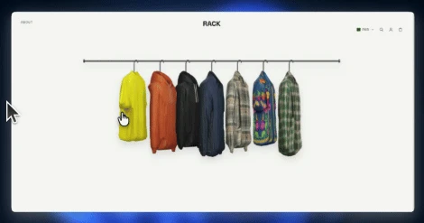

# RACK store

A clothing store laid out as a real clothes rail: pieces hang side-on in 3D, turn to face you on hover, and open into a product view on click.



```bash
pnpm install
pnpm dev
```

## Product photos

The rack is a real 3D scene (three.js). Each piece is built from its photos: the
outline of the front photo gives its shape, the outline of the side photo gives its
depth at every height (shoulders, collar, hanging sleeve, hood), and the photos are
printed on the matching faces, blending as the piece turns. The hanger and hook are
added in 3D.

Each product has a folder in `public/products/<slug>/` holding three photos:

| File        | What it shows                                          |
| ----------- | ------------------------------------------------------ |
| `front.png` | The garment facing the camera                          |
| `back.png`  | The back, framed the same way                          |
| `side.png`  | The garment from its side, **its front facing right**  |

- **Transparent background is required** (cut-out PNG or WebP). Shapes come from the transparency; a photo on a solid background becomes a rectangle.
- The easy way is the **admin panel** at `/admin` (the Admin button in the store header, shown only in `pnpm dev`). Drop a photo into a product's Front, Back or Side box: a plain studio background is removed in the browser, and Save frames it and writes it to `public/products/<slug>/`. Side photos have a Mirror button if the front faces left. Saving writes to this computer, so the panel and its API only run in development.
- To make photos with AI from a picture of real clothes, copy the generic prompt at the top of the admin panel. Per-product prompts that describe each item are in `PHOTO-PROMPTS.md`.
- No hanger in the photos, since it's added in 3D.
- Portrait 4:5 canvas (e.g. 1600×2000), garment centred, top of the collar touching the top edge, same scale in all three photos and across products.
- The side photo is what makes the rack look real from the side. Without it the depth is estimated and the sides take the front photo's colours.
- Until a product has photos, drawn placeholders are used.

## Admin panel

Run `pnpm dev` and click **Admin** in the store header (or open `/admin`). From there you can:

- **Add an item** (name, price, type, colour, stock per size, description) and **remove** one. Removing an item also deletes its photos.
- **Set the rack size**: a minimum and maximum number of items. Adding is blocked when the rack is full and removing when it's at the minimum. Up to 24 items fit; the rack splits into rails of up to 10.
- **Copy the AI photo prompt**: one prompt for any item. Attach a photo of the clothes in Gemini or ChatGPT, paste it, and it makes the front, back and side photos.
- **Add photos** to each item (see above).

Items and the rack size are stored in `data/catalog.json`; photos in `public/products/`. The panel and its API only run in development, since they write to this computer's disk. The brand name is `BRAND` in `src/lib/products.ts`.
